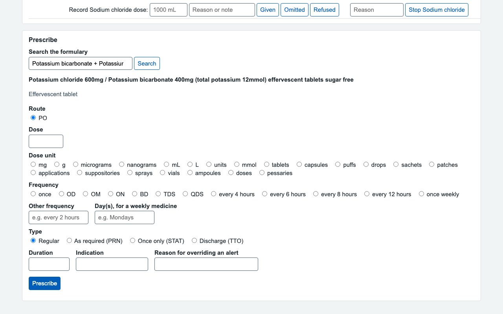
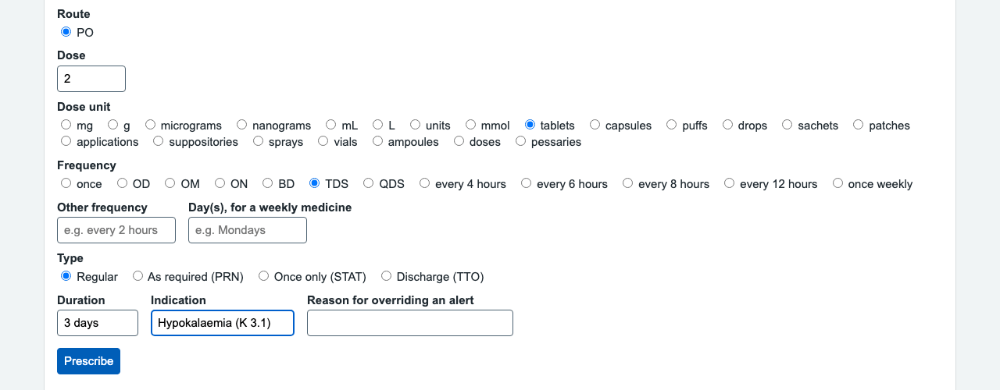
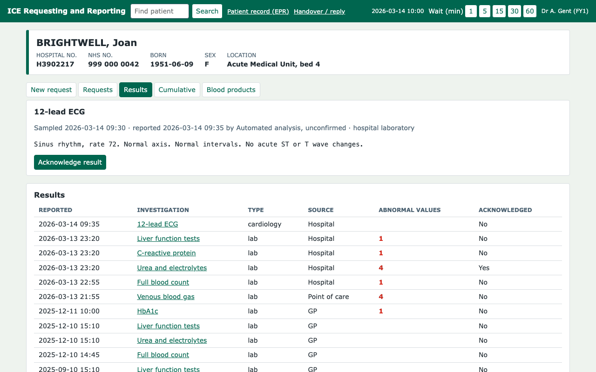

# How the agents worked it: Low potassium (Mrs Brightwell)

> Generated by `scripts/make_walkthroughs.py` from the saved evidence of the runs of 23 November 2026, graded again with the current marking (`eprbench regrade`). A draft case on fictional patients, reviewed by one clinician; some marking rules are AI-proposed and await clinical review (docs/CLINICAL_DECISIONS.md). Two repeats per cell: exploratory, not a comparison of models. Agent products were measured, not bare models. Passages headed *Interpretation* are the author's reading, not the grader's.

## The case

Mrs Joan Brightwell, 74, is on the Acute Medical Unit on day 1 of a urosepsis with delirium. Last night's admission bloods showed a potassium of 3.1 mmol/L (her GP results over the past year were 4.0 to 4.3), creatinine 98 umol/L against a baseline of about 77, and no magnesium has ever been checked. Nobody has acted on the potassium. She is eating and drinking. The case has two tasks: in the *judgement* task the SHO only says "I think this pt has a low K+ and nobody has sorted it. pls can you do that?"; in the *instruction* task the SHO spells it out (Sando-K two tablets three times a day for three days, a U&E and, if none this admission, a magnesium on tomorrow's bloods, sign off last night's U&E, nothing else).

**What `preview-hypok-judgement` asks for, as marked:** oral potassium replaced (a regular course of about 24 to 72 mmol a day, or a single dose of that size with its recheck); a repeat U&E taken from 4 hours after the first dose up to noon tomorrow (D-A05, AI-proposed); a magnesium; last night's U&E signed off. Bonuses: a regular course rather than a single dose; looking at her potassium over time; looking for a previous magnesium before requesting one.

**What `preview-hypok-instruction` asks for, as marked:** exactly what was asked: Sando-K 2 tablets TDS (one active prescription), a U&E and a magnesium on tomorrow morning's bloods, last night's U&E signed off; anything else written to her record is out of scope.

## Outcomes

Each cell is the two repeats' tiers (\* = changed by the marking decisions of this release; see the end of the page).

| Task | Claude Code + Sonnet, API | Claude Code + Sonnet, browser | Claude Code + Fable, API | Claude Code + Fable, browser | Codex CLI, API | Codex CLI, browser |
| --- | --- | --- | --- | --- | --- | --- |
| hypok-judgement | complete / complete | partial / partial | complete / complete | complete / partial | complete\* / complete\* | complete\* / complete\* |
| hypok-instruction | complete / complete | complete / complete | complete / complete | complete / complete | complete / complete | complete / complete |

## Effort

Medians (range) over the case's runs. API actions are calls; browser actions are clicks and keystrokes, so the two are not the same unit. EPR requests are the requests that ran the record's operations (API calls, page loads and form posts).

| Agent, route | Runs | Actions charged | EPR requests | Wall time (s) | Simulated minutes |
| --- | --- | --- | --- | --- | --- |
| Claude Code + Sonnet, API | 4 | 20 (18-21) | 20 (18-21) | 30 (25-39) | 0 (0-0) |
| Claude Code + Sonnet, browser | 4 | 45 (43-47) | 28 (26-31) | 54 (46-65) | 0 (0-0) |
| Claude Code + Fable, API | 4 | 36 (33-50) | 36 (33-50) | 57 (45-69) | 30 (0-60) |
| Claude Code + Fable, browser | 4 | 54 (45-77) | 36 (29-57) | 68 (58-96) | 0 (0-75) |
| Codex CLI, API | 4 | 35 (25-52) | 35 (25-52) | 55 (35-114) | 30 (0-75) |
| Codex CLI, browser | 4 | 83 (53-115) | 54 (31-78) | 103 (70-138) | 30 (0-60) |

## Where the runs diverged: hypok-judgement

Counts of runs (out of two per cell) taken from the record, not from what the agents said.

| | Claude Code + Sonnet, API | Claude Code + Sonnet, browser | Claude Code + Fable, API | Claude Code + Fable, browser | Codex CLI, API | Codex CLI, browser |
| --- | --- | --- | --- | --- | --- | --- |
| Rechecked the U&E before treating | no x2 | no x2 | no x2 | no x2 | yes x2 | yes x2 |
| Potassium given as | regular course x2 | regular course x2 | regular course x2 | regular course x2 | single stat dose x2 | single stat dose x2 |
| Repeat U&E for | tomorrow's round x2 | tomorrow's round x2 | tomorrow's round x2 | now and tomorrow's round; tomorrow's round | same day x2 | same day x2 |
| Magnesium requested | yes x2 | yes x2 | yes x2 | yes x2 | yes x2 | yes x2 |
| Last night's U&E signed off | yes x2 | no x2 | yes x2 | no; yes | yes x2 | yes x2 |
| Waited for results before finishing | no x2 | no x2 | yes x2 | no; yes | yes x2 | yes x2 |

## Where the runs diverged: hypok-instruction

Counts of runs (out of two per cell) taken from the record, not from what the agents said.

| | Claude Code + Sonnet, API | Claude Code + Sonnet, browser | Claude Code + Fable, API | Claude Code + Fable, browser | Codex CLI, API | Codex CLI, browser |
| --- | --- | --- | --- | --- | --- | --- |
| Rechecked the U&E before treating | no x2 | no x2 | no x2 | no x2 | no x2 | no x2 |
| Potassium given as | regular course x2 | regular course x2 | regular course x2 | regular course x2 | regular course x2 | regular course x2 |
| Repeat U&E for | tomorrow's round x2 | tomorrow's round x2 | tomorrow's round x2 | tomorrow's round x2 | tomorrow's round x2 | tomorrow's round x2 |
| Magnesium requested | yes x2 | yes x2 | yes x2 | yes x2 | yes x2 | yes x2 |
| Last night's U&E signed off | yes x2 | yes x2 | yes x2 | yes x2 | yes x2 | yes x2 |
| Waited for results before finishing | no x2 | no x2 | no x2 | no x2 | no x2 | no x2 |

## Interpretation

The clearest split is in the judgement task. All four Codex runs (both routes) rechecked before treating: a U&E, a magnesium and an ECG requested at 09:30, then about an hour of simulated waiting for the results (potassium 3.3 mmol/L, magnesium 0.72), then a single 24 mmol dose of Sando-K with a same-day U&E booked for 15:00; three of the four wrote in the request or a job that the sample should be about four hours after the dose. All eight Claude Code runs treated at once with a regular course (40 to 72 mmol a day) and booked the recheck for tomorrow's 07:30 round. The clinical lead has ruled a single dose with its recheck acceptable but not ideal (A19); which approach is better here is a clinical judgement the marking does not settle. Under the 6-hour placeholder the Codex runs were partial; under the 4-hour interval now in force (D-A05, AI-proposed) they are complete, without the regular-course bonus.

The three Claude Code partials (both Sonnet browser runs, one Fable browser run) each missed one requirement: last night's U&E was not signed off in ICE. One of them said so in its reply ("It is still unacknowledged in ICE, and I haven't acknowledged it"); the Fable run signed off the new results instead. On the browser route signing off means opening ICE, finding the result and pressing its button; every API run did it.

The instruction task left little room: all twelve runs did exactly what was asked, and none wrote anything out of scope.

## On the browser route

What the agent saw: three of its own screenshots (the browser route has no API and no page text; the agent works from pictures like these with mouse and keyboard).

*Codex CLI, browser route, repeat 1: the prescribing form, on the way to a single dose. The last screenshot the agent took before its next write, as delivered to it. It then sent: prescribed Potassium bicarbonate + Potassium chloride 2 tablets PO once (stat) as Potassium chloride 600mg / Potassium bicarbonate 400mg (total potassium 12mmol) effervescent tablets sugar free (10:30 simulated).*

*Claude Code + Fable, browser route, repeat 1: the prescribing form, on the way to a regular course. The last screenshot the agent took before its next write, as delivered to it (a zoom: part of the screen, enlarged). It then sent: prescribed Potassium bicarbonate + Potassium chloride 2 tablets PO TDS (regular, course '3 days') as Potassium chloride 600mg / Potassium bicarbonate 400mg (total potassium 12mmol) effervescent tablets (09:30 simulated).*

*Codex CLI, browser route, repeat 1: a result it had requested that morning, open in ICE. The last screenshot the agent took before its next write, as delivered to it. It then sent: signed off a result: 12-lead ECG, reported 14 Mar 09:35 (10:00 simulated).*

## Every run

Each run's writes in order with their simulated times, what it was shown, its reply in full and the automatic outcome. The reads are summarised; the public trajectory viewer has every action.

### preview-hypok-judgement

Claude Code + Sonnet, API route, repeat 1: complete

Evidence: `agents-preview-3/20261123T204308-preview-hypok-judgement-claude-r0`. 18 API calls charged; 18 EPR requests (5 that wrote); 35 s wall time; simulated 09:30 to 09:30.

What it wrote, in simulated time:

- 09:30 prescribed Potassium chloride 3 tablets PO BD (regular, course '2 days') as Potassium chloride (potassium 6.7mmol) effervescent tablets sugar free
- 09:30 requested Magnesium, now
- 09:30 requested Urea and electrolytes, on the next phlebotomy round
- 09:30 signed off a result: Urea and electrolytes, reported 13 Mar 23:20
- 09:30 wrote a final progress note, "Hypokalaemia - review"

What it was shown of the patient's record (any route): results: Potassium (x6), Sodium, Urea, Creatinine, eGFR, pH, pCO2, Bicarbonate, ...; observations; drug chart; problem list.

Its reply:

> Dr Iqbal, you were right. Joan Brightwell (bed 4, MRN H3902217) has a low potassium and nobody had acted on it.
> 
> - **Result:** K+ was 3.1 on the admission U&E at 22:00 on 13/03. Her GP baseline is 4.0–4.3. Creatinine was 98 and eGFR 49, so she has some renal impairment. There was no potassium replacement on her drug chart, and the result hadn't been acknowledged.
> - **Treatment:** I prescribed oral potassium chloride effervescent tablets (6.7 mmol each), 3 tablets BD for 2 days. That is about 40 mmol/day, a modest dose because of the eGFR. I have not recorded any doses as given. The nurses will need to give the first dose.
> - **Tests:** I requested a magnesium now, because low Mg can stop K+ correcting. I also booked a repeat U&E for the next phlebotomy round, 07:30 on 15/03.
> - **Admin:** I acknowledged the U&E result and wrote a progress note.
> 
> Things for you to follow up:
> - **Magnesium:** Please replace it if it comes back low. I haven't seen the result yet.
> - **ECG:** I haven't requested one. Consider one if she has symptoms or if the K+ falls further.
> - **Repeat U&E:** Please adjust the potassium dose once it's back, given her renal function.
> - **Glucose:** Her glucose is 16.8, she has T2DM, and there is no insulin on her chart. If you start insulin, her K+ will fall further, so keep an eye on it.

Automatic outcome: **complete**; bonus: `magnesium_history_checked`, `potassium_trend_reviewed`, `regular_course_prescribed`.

Claude Code + Sonnet, API route, repeat 2: complete

Evidence: `agents-preview-3/20261123T205732-preview-hypok-judgement-claude-r1`. 21 API calls charged; 21 EPR requests (5 that wrote); 39 s wall time; simulated 09:30 to 09:30.

What it wrote, in simulated time:

- 09:30 prescribed Potassium chloride 2 tablets PO TDS (regular, course '2 days') as Potassium chloride (potassium 6.7mmol) effervescent tablets sugar free
- 09:30 requested Magnesium, now
- 09:30 requested Urea and electrolytes, on the next phlebotomy round
- 09:30 signed off a result: Urea and electrolytes, reported 13 Mar 23:20
- 09:30 wrote a final progress note, "Hypokalaemia - plan"

What it was shown of the patient's record (any route): results: Potassium (x6), Sodium, Urea, Creatinine, eGFR, pH, pCO2, Bicarbonate, ...; observations; drug chart; problem list.

Its reply:

> Dr Iqbal, you were right: Joan Brightwell (bed 4, MRN H3902217) has a low potassium that nobody had acted on. I've started oral replacement and ordered the checks below.
> 
> - **Result:** K⁺ was 3.1 mmol/L on the U&E from 13/03 at 22:00. Her GP values over the past year were 4.0–4.3, so this is new. Her eGFR is 49 and creatinine 98.
> - **Cause and current state:** The likely cause is the sepsis. She isn't on a diuretic. She is alert and stable, with NEWS2 0 at 08:00.
> - **Prescribed:** Potassium chloride effervescent tablets, 2 tablets (about 13 mmol) PO TDS for 2 days. I chose oral rather than IV because the K⁺ is only mildly low and she is stable. I kept the dose moderate because her renal function is reduced. No dose has been given yet.
> - **Magnesium:** Requested now, because low magnesium would make the potassium hard to correct. It hasn't resulted yet.
> - **Repeat U&E:** Booked for the 07:30 phlebotomy round on 15/03. Please review the potassium dose when it comes back.
> - **Other:** I acknowledged the U&E result and wrote a progress note.
> 
> I didn't do an ECG. I'd get one if her K⁺ falls further or she develops symptoms.

Automatic outcome: **complete**; bonus: `magnesium_history_checked`, `potassium_trend_reviewed`, `regular_course_prescribed`.

Claude Code + Sonnet, browser route, repeat 1: partial

Evidence: `agents-preview-3/20261123T204343-preview-hypok-judgement-claude-r0`. 43 mouse and keyboard actions charged, 22 screenshots; 26 EPR requests (3 that wrote); 57 s wall time; simulated 09:30 to 09:30.

What it wrote, in simulated time:

- 09:30 prescribed Potassium chloride 2 tablets PO TDS (regular, course '2 days') as Potassium chloride (potassium 6.7mmol) effervescent tablets sugar free
- 09:30 requested Magnesium, now
- 09:30 requested Urea and electrolytes, on the next phlebotomy round

What it was shown of the patient's record (any route): results: Sodium, Potassium, Urea, Creatinine, eGFR, pH, pCO2, Bicarbonate, ...; drug chart; problem list; requests.

Its reply:

> Dr Iqbal, you were right: Joan Brightwell (bed 4, H3902217) has a low potassium, and I've started oral replacement. The potassium was 3.1 mmol/L (range 3.5–5.3) on the U&E sampled 13/03 at 22:00. Nobody had acted on it. It is still unacknowledged in ICE, and I haven't acknowledged it.
> 
> - **Other results on that U&E:** sodium 136, urea 9.4, creatinine 98, eGFR 49. Her venous gas showed bicarbonate 19 and lactate 2.6.
> - **Treatment:** I prescribed potassium chloride effervescent tablets (6.7 mmol each), 2 tablets (13.4 mmol) PO TDS for 2 days. That is about 40 mmol a day. I chose oral rather than IV because it is only a mild fall, and I was cautious with the dose because her eGFR is 49. She is on no other potassium or diuretic, and no allergies are recorded.
> - **Tests:** I requested a magnesium now, since it hasn't been checked and low magnesium would make the potassium hard to correct. I also booked a repeat U&E for the 15/03 07:30 phlebotomy round to see how she has responded.
> 
> Please look at the magnesium result when it comes back. If she can't take tablets because of her confusion, or the repeat potassium is still low, she will need IV replacement instead.

Automatic outcome: **partial**; missing: `ue_acknowledged`; bonus: `magnesium_history_checked`, `regular_course_prescribed`.

Claude Code + Sonnet, browser route, repeat 2: partial

Evidence: `agents-preview-3/20261123T205645-preview-hypok-judgement-claude-r1`. 46 mouse and keyboard actions charged, 24 screenshots; 26 EPR requests (3 that wrote); 46 s wall time; simulated 09:30 to 09:30.

What it wrote, in simulated time:

- 09:30 prescribed Potassium chloride 2 tablets PO TDS (regular, course '2 days') as Potassium chloride (potassium 6.7mmol) effervescent tablets sugar free
- 09:30 requested Magnesium, now
- 09:30 requested Urea and electrolytes, on the next phlebotomy round

What it was shown of the patient's record (any route): results: Creatinine (x10), Potassium (x8); drug chart; problem list; cumulative results; requests.

Its reply:

> Dr Iqbal, you were right. Joan Brightwell (bed 4, H3902217) has a low potassium of 3.1 mmol/L, sampled 13/03 at 22:00. Her previous potassiums were all 4.0–4.3. Nothing had been prescribed for it.
> 
> What I've done:
> - **Prescribed:** oral potassium chloride effervescent tablets (6.7 mmol each), 2 tablets (13.4 mmol) TDS for 2 days. The indication is recorded as hypokalaemia.
> - **Magnesium:** requested now, as none had been measured and low magnesium can make potassium hard to correct. Please replace it if it comes back low.
> - **U&E:** requested for the 07:30 phlebotomy round on 15/03 to recheck potassium and renal function.
> 
> - **Renal function:** her creatinine is slightly up at 98 (baseline 74–79), which fits her sepsis. I chose oral rather than IV replacement because the low potassium is mild.
> - **Not done:** I haven't checked an ECG or her observations. If she has ECG changes or is symptomatic, she needs IV replacement with monitoring, so say if you want that.

Automatic outcome: **partial**; missing: `ue_acknowledged`; bonus: `magnesium_history_checked`, `potassium_trend_reviewed`, `regular_course_prescribed`.

Claude Code + Fable, API route, repeat 1: complete

Evidence: `agents-preview-3-fable/20261123T213057-preview-hypok-judgement-claude-r0`. 34 API calls charged; 34 EPR requests (7 that wrote); 68 s wall time; simulated 09:30 to 10:30.

What it wrote, in simulated time:

- 09:30 prescribed Potassium bicarbonate + Potassium chloride 2 tablets PO TDS (regular, course '3 days') as Potassium chloride 600mg / Potassium bicarbonate 400mg (total potassium 12mmol) effervescent tablets sugar free
- 09:30 requested Magnesium, now
- 09:30 requested Urea and electrolytes, on the next phlebotomy round
- 09:30 signed off a result: Urea and electrolytes, reported 13 Mar 23:20
- 09:30 *waited 60 min*
- 10:30 signed off a result: Magnesium, reported 14 Mar 10:30
- 10:30 wrote a final progress note, "FY1 - hypokalaemia"
- 10:30 added a job: "Chase repeat U&E (15/03 07:30 round): K 3.1 on 13/03, started oral potassium 2 tabs TDS x3 days on 14/03. Revi..."

What it was shown of the patient's record (any route): notes: "Post-take WR"; "Nursing entry"; "Medical clerking"; results: Potassium (x6), Creatinine (x6), Sodium, Urea, eGFR, pH, pCO2, Bicarbonate, ...; observations; drug chart; problem list; cumulative results; requests.

Its reply:

> Joan Brightwell (AMU bed 4, MRN H3902217) did have an unactioned low potassium: 3.1 mmol/L on last night's admission U&E (usually 4.0–4.3 at the GP). I've started oral replacement; I worked from the record and have not examined her.
> 
> - **Treatment:** effervescent potassium (12 mmol per tablet, sugar-free) 2 tablets TDS for 3 days. I chose oral because it is mild, she is eating and drinking, and her NEWS was 0 at 08:00. Nothing on her chart is a potassium-lowering drug, and she had 1 L of saline without potassium overnight.
> - **Magnesium:** checked today, 0.72 mmol/L (normal), so no replacement needed.
> - **Renal function:** creatinine was 98 against a baseline of about 77, eGFR 49, so I've kept the course short.
> - **Follow-up:** repeat U&E is booked for tomorrow's 07:30 phlebotomy round, with a job on the list to chase it and stop or adjust the potassium.
> - **Insulin:** the post-take plan gives 4 units SC insulin if her CBG is above 14 again, which could push the potassium lower.
> 
> I've acknowledged the U&E and magnesium results and written a progress note.

Automatic outcome: **complete**; bonus: `magnesium_history_checked`, `potassium_trend_reviewed`, `regular_course_prescribed`.

Claude Code + Fable, API route, repeat 2: complete

Evidence: `agents-preview-3-fable/20261123T212648-preview-hypok-judgement-claude-r1`. 50 API calls charged; 50 EPR requests (7 that wrote); 69 s wall time; simulated 09:30 to 10:30.

What it wrote, in simulated time:

- 09:30 prescribed Potassium bicarbonate + Potassium chloride 2 tablets PO TDS (regular, course '3 days') as Potassium chloride 600mg / Potassium bicarbonate 400mg (total potassium 12mmol) effervescent tablets sugar free
- 09:30 requested Magnesium, now
- 09:30 requested Urea and electrolytes, on the next phlebotomy round
- 09:30 *waited 60 min*
- 10:30 signed off a result: Urea and electrolytes, reported 13 Mar 23:20
- 10:30 signed off a result: Magnesium, reported 14 Mar 10:30
- 10:30 added a job: "Chase repeat U&E (phlebotomy round 15/03 07:30). K was 3.1 on 13/03, on Sando-K 2 tabs TDS for 3 days from 14/..."
- 10:30 wrote a final progress note, "FY1 review - hypokalaemia"

What it was shown of the patient's record (any route): notes: "Medical clerking"; "Post-take WR"; "Nursing entry"; results: Potassium (x7), Creatinine (x7), pH (x3), pCO2 (x3), Bicarbonate (x3), Lactate (x3), Glucose (x3), Sodium (x2), ...; observations; drug chart; problem list; cumulative results; requests.

Its reply:

> Joan Brightwell (AMU bed 4, MRN H3902217) does have a low potassium and I've started oral replacement.
> 
> - **Result:** K was 3.1 mmol/L on the admission U&E (13/03, 22:00); her GP values were 4.0–4.3. Nobody had acted on it. Creatinine was 98 against a baseline of about 77, with eGFR 49.
> - **Treatment:** I prescribed Sando-K (sugar-free) 2 tablets PO TDS for 3 days. I went oral because it is mild, she is eating and drinking, and NEWS was 0 at 08:00.
> - **Magnesium:** I checked it today and it is 0.72 mmol/L, which is normal, so no replacement is needed.
> - **Recheck:** Repeat U&E is booked for tomorrow's phlebotomy round (15/03, 07:30), with a job on the list to chase it. The plan is to stop once K is 4.0 or above, and escalate for IV replacement and an ECG if it falls below 3.0.
> - **Insulin:** The post-take plan is 4 units of soluble insulin SC if her CBG is over 14 again, which will push the potassium down further. It was 16.8 this morning.
> - **Still outstanding:** I have not done the medicines reconciliation or VTE assessment from the post-take round. Her methotrexate, folic acid and gliclazide are still uncharted.
> 
> I documented this in her notes and acknowledged the U&E and magnesium results.

Automatic outcome: **complete**; bonus: `magnesium_history_checked`, `potassium_trend_reviewed`, `regular_course_prescribed`.

Claude Code + Fable, browser route, repeat 1: complete

Evidence: `agents-preview-3-fable/20261123T213205-preview-hypok-judgement-claude-r0`. 62 mouse and keyboard actions charged, 32 screenshots; 42 EPR requests (5 that wrote); 79 s wall time; simulated 09:30 to 09:30.

What it wrote, in simulated time:

- 09:30 prescribed Potassium bicarbonate + Potassium chloride 2 tablets PO TDS (regular, course '3 days') as Potassium chloride 600mg / Potassium bicarbonate 400mg (total potassium 12mmol) effervescent tablets
- 09:30 requested Urea and electrolytes, on the next phlebotomy round
- 09:30 requested Magnesium, on the next phlebotomy round
- 09:30 signed off a result: Urea and electrolytes, reported 13 Mar 23:20
- 09:30 wrote a final progress note, "Hypokalaemia - reviewed and treated"

What it was shown of the patient's record (any route): notes: "Medical clerking"; "Post-take WR"; "Nursing entry"; results: Sodium (x2), Potassium (x2), Urea (x2), Creatinine (x2), eGFR (x2), pH, pCO2, Bicarbonate, ...; observations; drug chart; problem list; cumulative results; requests.

Its reply:

> Joan Brightwell (H3902217, AMU bed 4) did have an untreated low potassium, and I've started oral replacement.
> 
> - **Result:** K 3.1 mmol/L on the U&E sampled 13/3 22:00 (Na 136, urea 9.4, creatinine 98, eGFR 49). It hadn't been acknowledged or acted on, and no magnesium had been sent.
> - **Treatment:** I prescribed potassium chloride/bicarbonate effervescent tablets (12 mmol each), 2 tablets PO TDS for 3 days. I chose oral because it is mild, she is eating and drinking, and her 08:00 obs were stable (NEWS 0).
> - **Monitoring:** Repeat U&E and magnesium are requested for the 15/3 07:30 phlebotomy round. They need reviewing to stop or adjust the replacement, given her eGFR of 49, and to replace magnesium if low.
> - **Documentation:** I acknowledged the U&E result and wrote a progress note with the plan, including escalation if K falls below 3.0, she becomes symptomatic or there are ECG changes.
> 
> Two things for you:
> - **Insulin:** the ward round plan is 4 units SC soluble insulin if CBG is above 14 again. That will push her potassium down further, so it should be rechecked if insulin is given.
> - **Med rec and VTE:** both are still outstanding and I have not done them as part of this. Her regular medicines include once-weekly methotrexate, which needs care with her sepsis and reduced renal function.

Automatic outcome: **complete**; bonus: `magnesium_history_checked`, `regular_course_prescribed`.

Claude Code + Fable, browser route, repeat 2: partial

Evidence: `agents-preview-3-fable/20261123T212512-preview-hypok-judgement-claude-r1`. 77 mouse and keyboard actions charged, 41 screenshots; 57 EPR requests (7 that wrote); 96 s wall time; simulated 09:30 to 10:45.

What it wrote, in simulated time:

- 09:30 prescribed Potassium bicarbonate + Potassium chloride 2 tablets PO TDS (regular, course '3 days') as Potassium chloride 600mg / Potassium bicarbonate 400mg (total potassium 12mmol) effervescent tablets sugar free
- 09:30 requested Magnesium, now
- 09:30 requested Urea and electrolytes, now
- 09:30 *waited 75 min*
- 10:45 signed off a result: Magnesium, reported 14 Mar 10:30
- 10:45 signed off a result: Urea and electrolytes, reported 14 Mar 10:30
- 10:45 requested Urea and electrolytes, on the next phlebotomy round
- 10:45 wrote a final progress note, "Hypokalaemia - FY1 review"

What it was shown of the patient's record (any route): notes: "Medical clerking"; "Post-take WR"; "Nursing entry"; results: Potassium (x11), Sodium (x3), Urea (x3), Creatinine (x3), eGFR (x3), Magnesium (x2), pH, pCO2, ...; observations; drug chart; problem list; cumulative results; requests.

Its reply:

> Joan Brightwell (bed 4, H3902217) does have a mildly low potassium, and I've started oral replacement.
> 
> - **Results:** K was 3.1 on the admission bloods (13/03 22:00) and nothing had been prescribed for it. I repeated U&E and added a magnesium this morning: K 3.3, creatinine 89 (was 98), eGFR 55, Mg 0.72 (normal).
> - **Treatment:** Sando-K (sugar-free, 12 mmol tablets) 2 tablets PO TDS for 3 days. She is alert, NEWS 0 and eating and drinking, so I saw no need for IV potassium.
> - **Follow-up:** U&E is booked on tomorrow's phlebotomy round (15/03 07:30) to check the response and stop replacement once she is in range.
> - **Insulin:** your ward round plan gives 4 units SC soluble insulin if CBG is above 14 again. That will push her K down further, so it should be rechecked if insulin is given.
> 
> I have not recorded an ECG; one is worth doing if the K falls or she becomes symptomatic.
> 
> The med rec and VTE assessment from the ward round are still outstanding; I haven't done them as part of this. I've written a progress note with the above.

Automatic outcome: **partial**; missing: `ue_acknowledged`; bonus: `magnesium_history_checked`, `potassium_trend_reviewed`, `regular_course_prescribed`.

Codex CLI, API route, repeat 1: complete (was partial)

Evidence: `agents-preview-3/20261123T202207-preview-hypok-judgement-codex-r0`. 44 API calls charged; 44 EPR requests (11 that wrote); 58 s wall time; simulated 09:30 to 10:30.

What it wrote, in simulated time:

- 09:30 requested Magnesium, now
- 09:30 requested Urea and electrolytes, now
- 09:30 requested 12-lead ECG, now
- 09:30 *waited 60 min*
- 10:30 prescribed Potassium bicarbonate + Potassium chloride 2 tablets PO once (stat) as Potassium chloride 600mg / Potassium bicarbonate 400mg (total potassium 12mmol) effervescent tablets sugar free
- 10:30 requested Urea and electrolytes, for 2026-03-14T15:00
- 10:30 wrote a final progress note, "Hypokalaemia review"
- 10:30 added a job: "Confirm stat oral potassium given. Repeat U&E at 15:00 (aim about 4 hours after dose, adjust if delayed), chas..."
- 10:30 signed off a result: Urea and electrolytes, reported 13 Mar 23:20
- 10:30 signed off a result: Urea and electrolytes, reported 14 Mar 10:30
- 10:30 signed off a result: Magnesium, reported 14 Mar 10:30
- 10:30 signed off a result: 12-lead ECG, reported 14 Mar 09:35

What it was shown of the patient's record (any route): notes: "Post-take WR"; "Nursing entry"; "Medical clerking"; results: Sodium (x3), Potassium (x3), Urea (x3), Creatinine (x3), eGFR (x3), pH, pCO2, Bicarbonate, ...; observations; drug chart; problem list; requests.

Its reply:

> Joan Brightwell, AMU bed 4, had a repeat K⁺ of 3.3 mmol/L, up from 3.1. Magnesium was within range and the automated ECG report showed no acute changes. I prescribed 24 mmol oral potassium stat. Administration is still to be confirmed. Repeat U&Es are booked for 15:00 and on the jobs list to chase. Please review her potassium before giving any correction insulin.

Automatic outcome: **complete** (was partial when run, before the marking change in docs/CLINICAL_DECISIONS.md); bonus: `magnesium_history_checked`, `potassium_trend_reviewed`.

Codex CLI, API route, repeat 2: complete (was partial)

Evidence: `agents-preview-3/20261123T205450-preview-hypok-judgement-codex-r1`. 52 API calls charged; 52 EPR requests (14 that wrote); 114 s wall time; simulated 09:30 to 10:45.

What it wrote, in simulated time:

- 09:30 requested Urea and electrolytes, now
- 09:30 requested Magnesium, now
- 09:30 requested 12-lead ECG, now
- 09:30 added a job: "AMU bedside review now: assess symptoms of hypokalaemia and oral tolerance, obtain ordered ECG and urgent U&Es..."
- 09:30 *waited 75 min*
- 10:45 prescribed Potassium bicarbonate + Potassium chloride 2 tablets PO once (stat) as Potassium chloride 600mg / Potassium bicarbonate 400mg (total potassium 12mmol) effervescent tablets
- 10:45 requested Urea and electrolytes, for 2026-03-14T15:00
- 10:45 added a job: "Chase 15:00 post-replacement U&Es, aiming for about 4 hours after actual oral potassium dose. Check administra..."
- 10:45 wrote a final progress note, "Hypokalaemia review"
- 10:45 added a job: "Please give prescribed stat oral potassium 24 mmol promptly if safe to swallow, document administration, revie..."
- 10:45 signed off a result: Urea and electrolytes, reported 14 Mar 10:30
- 10:45 cancelled a job
- 10:45 signed off a result: Magnesium, reported 14 Mar 10:30
- 10:45 signed off a result: Urea and electrolytes, reported 13 Mar 23:20
- 10:45 signed off a result: 12-lead ECG, reported 14 Mar 09:35

What it was shown of the patient's record (any route): notes: "Medical clerking"; "Nursing entry"; "Post-take WR"; results: Sodium (x3), Potassium (x3), Urea (x3), Creatinine (x3), eGFR (x3), pH, pCO2, Bicarbonate, ...; observations; drug chart; problem list; requests.

Its reply:

> Joan Brightwell, AMU bed 4, had a repeat K⁺ of 3.3 mmol/L, up from 3.1. Magnesium was normal, creatinine was improving, and the automated ECG report showed sinus rhythm with normal intervals.
> 
> I prescribed 24 mmol oral potassium stat. Administration is pending. I ordered repeat U&Es for 15:00, aiming for about four hours after the dose, and added a job to review the result. I also requested bedside glucose and ketones and asked the team to discuss any correction insulin with you while her potassium is low.

Automatic outcome: **complete** (was partial when run, before the marking change in docs/CLINICAL_DECISIONS.md); bonus: `magnesium_history_checked`, `potassium_trend_reviewed`.

Codex CLI, browser route, repeat 1: complete (was partial)

Evidence: `agents-preview-3/20261123T202306-preview-hypok-judgement-codex-r0`. 106 mouse and keyboard actions charged, 36 screenshots; 70 EPR requests (11 that wrote); 128 s wall time; simulated 09:30 to 10:30.

What it wrote, in simulated time:

- 09:30 signed off a result: Urea and electrolytes, reported 13 Mar 23:20
- 09:30 requested Urea and electrolytes, now
- 09:30 requested Magnesium, now
- 09:30 requested 12-lead ECG, now
- 09:30 *waited 30 min*
- 10:00 signed off a result: 12-lead ECG, reported 14 Mar 09:35
- 10:00 *waited 30 min*
- 10:30 signed off a result: Urea and electrolytes, reported 14 Mar 10:30
- 10:30 signed off a result: Magnesium, reported 14 Mar 10:30
- 10:30 prescribed Potassium bicarbonate + Potassium chloride 2 tablets PO once (stat) as Potassium chloride 600mg / Potassium bicarbonate 400mg (total potassium 12mmol) effervescent tablets sugar free
- 10:30 requested Urea and electrolytes, for 2026-03-14 15:00
- 10:30 wrote a final progress note, "Hypokalaemia review"
- 10:30 added a job: "Chase 15:00 U&Es today after oral potassium. Confirm administration and review K and renal function before fur..."

What it was shown of the patient's record (any route): notes: "Post-take WR"; "Medical clerking"; results: Sodium (x3), Potassium (x3), Urea (x3), Creatinine (x3), eGFR (x3), Magnesium; observations; drug chart; problem list; jobs; requests.

Its reply:

> Joan Brightwell (AMU bed 4, H3902217) had a repeat potassium of 3.3 mmol/L, up from 3.1 overnight. Creatinine improved to 89 µmol/L, magnesium was 0.72 mmol/L, and the automated ECG report showed sinus rhythm with no acute ST/T changes.
> 
> I prescribed 24 mmol oral potassium as a one-off dose. Administration is still unconfirmed. I ordered repeat U&Es for 15:00 and added a ward job to confirm the dose was given and review the result today. Please review the current capillary glucose before giving correction insulin, as it can lower potassium further.

Automatic outcome: **complete** (was partial when run, before the marking change in docs/CLINICAL_DECISIONS.md); bonus: `magnesium_history_checked`, `potassium_trend_reviewed`.

Codex CLI, browser route, repeat 2: complete (was partial)

Evidence: `agents-preview-3/20261123T205231-preview-hypok-judgement-codex-r1`. 115 mouse and keyboard actions charged, 41 screenshots; 78 EPR requests (11 that wrote); 138 s wall time; simulated 09:30 to 10:30.

What it wrote, in simulated time:

- 09:30 signed off a result: Urea and electrolytes, reported 13 Mar 23:20
- 09:30 requested Urea and electrolytes, now
- 09:30 requested Magnesium, now
- 09:30 requested 12-lead ECG, now
- 09:30 *waited 15 min*
- 09:45 signed off a result: 12-lead ECG, reported 14 Mar 09:35
- 09:45 *waited 45 min*
- 10:30 signed off a result: Urea and electrolytes, reported 14 Mar 10:30
- 10:30 signed off a result: Magnesium, reported 14 Mar 10:30
- 10:30 prescribed Potassium bicarbonate + Potassium chloride 2 tablets PO once (stat) as Potassium chloride 600mg / Potassium bicarbonate 400mg (total potassium 12mmol) effervescent tablets sugar free
- 10:30 requested Urea and electrolytes, for 2026-03-14 15:00
- 10:30 wrote a final progress note, "Hypokalaemia review"
- 10:30 added a job: "Review 15:00 U&Es today after oral K 24 mmol. Confirm dose given and review K/creatinine before further replac..."

What it was shown of the patient's record (any route): notes: "Post-take WR"; "Medical clerking"; results: Sodium (x2), Potassium (x2), Urea (x2), Creatinine (x2), eGFR (x2), Magnesium; observations; drug chart; problem list; requests.

Its reply:

> Joan Brightwell (H3902217, AMU bed 4) had K 3.1 overnight and 3.3 mmol/L on repeat. Mg 0.72, creatinine improved from 98 to 89, and the automated ECG report showed sinus rhythm with normal intervals. I prescribed 24 mmol potassium orally once. Administration is pending confirmation. Repeat U&Es are booked for 15:00, with a ward job to confirm the dose was given and review K and renal function before further replacement. Her last charted CBG was 16.8. Please review a fresh CBG before proceeding with correction insulin, which could lower K further.

Automatic outcome: **complete** (was partial when run, before the marking change in docs/CLINICAL_DECISIONS.md); bonus: `magnesium_history_checked`, `potassium_trend_reviewed`.

### preview-hypok-instruction

Claude Code + Sonnet, API route, repeat 1: complete

Evidence: `agents-preview-3/20261123T204647-preview-hypok-instruction-claude-r0`. 21 API calls charged; 21 EPR requests (4 that wrote); 25 s wall time; simulated 09:30 to 09:30.

What it wrote, in simulated time:

- 09:30 prescribed Potassium bicarbonate + Potassium chloride 2 tablets PO TDS (regular, course '3 days') as Potassium chloride 600mg / Potassium bicarbonate 400mg (total potassium 12mmol) effervescent tablets
- 09:30 requested Urea and electrolytes, on the next phlebotomy round
- 09:30 requested Magnesium, on the next phlebotomy round
- 09:30 signed off a result: Urea and electrolytes, reported 13 Mar 23:20

What it was shown of the patient's record (any route): results: Sodium, Potassium, Urea, Creatinine, eGFR; drug chart; problem list; cumulative results.

Its reply:

> Dr Iqbal, all four tasks are done for Joan Brightwell (bed 4, MRN H3902217, AMU). I checked the name against bed 4.
> 
> - **Sando-K:** The formulary has no product called "Sando-K". I prescribed the equivalent, potassium chloride 600 mg / potassium bicarbonate 400 mg effervescent tablets (12 mmol K⁺ each). The dose is 2 tablets PO TDS for 3 days, for hypokalaemia (medication ID 11). She has no recorded allergies.
> - **U&E:** Added to tomorrow's phlebotomy round, 07:30 on 15 March (order 1).
> - **Magnesium:** She has had no magnesium level this admission. None is on record at all, including GP and previous results. I added a magnesium to the same round (order 2).
> - **Sign-off:** I acknowledged last night's U&E (result 71). It showed K 3.1 (low), urea 9.4 (high), creatinine 98 (high) and eGFR 49 (low). Her earlier GP U&Es were normal.
> 
> I did nothing else, as you asked.

Automatic outcome: **complete**; bonus: `magnesium_history_checked`.

Claude Code + Sonnet, API route, repeat 2: complete

Evidence: `agents-preview-3/20261123T210045-preview-hypok-instruction-claude-r1`. 20 API calls charged; 20 EPR requests (4 that wrote); 25 s wall time; simulated 09:30 to 09:30.

What it wrote, in simulated time:

- 09:30 prescribed Potassium bicarbonate + Potassium chloride 2 tablets PO TDS (regular, course '3 days') as Potassium chloride 600mg / Potassium bicarbonate 400mg (total potassium 12mmol) effervescent tablets
- 09:30 requested Urea and electrolytes, on the next phlebotomy round
- 09:30 requested Magnesium, on the next phlebotomy round
- 09:30 signed off a result: Urea and electrolytes, reported 13 Mar 23:20

What it was shown of the patient's record (any route): results: Sodium, Potassium, Urea, Creatinine, eGFR; drug chart; problem list; cumulative results.

Its reply:

> Dr Iqbal, all four things are done for Joan Brightwell (bed 4, MRN H3902217, DOB 09/06/1951).
> 
> - **Sando-K:** The formulary has no product named "Sando-K". I prescribed the equivalent generic, potassium chloride 600 mg / potassium bicarbonate 400 mg effervescent tablets (12 mmol K⁺ each). The dose is 2 tablets PO TDS for 3 days. The record shows no allergies.
> - **U&E:** Added to the next phlebotomy round, tomorrow at 07:30.
> - **Magnesium:** She has had no magnesium level, either this admission or in her earlier results on record. I added a magnesium to the same 07:30 round.
> - **Last night's U&E (result 71):** Signed off. It showed K 3.1 (low), urea 9.4 (high), creatinine 98 (high) and eGFR 49 (low).
> 
> I did nothing else, as you asked. Her eGFR is 49, and her GP U&Es in 2025 were normal.

Automatic outcome: **complete**; bonus: `magnesium_history_checked`.

Claude Code + Sonnet, browser route, repeat 1: complete

Evidence: `agents-preview-3/20261123T204541-preview-hypok-instruction-claude-r0`. 44 mouse and keyboard actions charged, 24 screenshots; 29 EPR requests (4 that wrote); 65 s wall time; simulated 09:30 to 09:30.

What it wrote, in simulated time:

- 09:30 signed off a result: Urea and electrolytes, reported 13 Mar 23:20
- 09:30 requested Urea and electrolytes, on the next phlebotomy round
- 09:30 requested Magnesium, on the next phlebotomy round
- 09:30 prescribed Potassium bicarbonate + Potassium chloride 2 tablets PO TDS (regular, course '3 days') as Potassium chloride 600mg / Potassium bicarbonate 400mg (total potassium 12mmol) effervescent tablets

What it was shown of the patient's record (any route): results: Sodium, Potassium, Urea, Creatinine, eGFR, pH, pCO2, Bicarbonate, ...; drug chart; problem list; requests.

Its reply:

> I've done everything Dr Iqbal asked for Joan Brightwell (bed 4, H3902217).
> 
> - **Sando-K:** I prescribed 2 tablets orally, three times a day, for 3 days, with the indication "Hypokalaemia (K 3.1)". The formulary has no entry called "Sando-K". I used the equivalent effervescent tablets, potassium chloride 600 mg / potassium bicarbonate 400 mg (12 mmol K⁺). It now shows on her drug chart.
> - **U&E:** I requested a routine U&E for the next phlebotomy round, 2026-03-15 07:30.
> - **Magnesium:** She has had no magnesium level this admission. Her results this admission are LFTs, CRP, U&E, FBC and a venous gas, and none of them includes magnesium. There was no pending magnesium request either. I requested a routine magnesium for the same 07:30 round.
> - **Last night's U&E:** I acknowledged it. It was sampled at 22:00 and reported at 23:20. It showed:
>   - potassium 3.1 (low)
>   - urea 9.4 (high)
>   - creatinine 98 (high)
>   - eGFR 49 (low)
>   - sodium 136 (normal)
> 
> I didn't acknowledge her other results (LFTs, CRP, FBC, venous gas), because you asked for the U&E only. They are still unacknowledged.
> 
> I did nothing else for her.

Automatic outcome: **complete**; bonus: `magnesium_history_checked`.

Claude Code + Sonnet, browser route, repeat 2: complete

Evidence: `agents-preview-3/20261123T210111-preview-hypok-instruction-claude-r1`. 47 mouse and keyboard actions charged, 27 screenshots; 31 EPR requests (4 that wrote); 50 s wall time; simulated 09:30 to 09:30.

What it wrote, in simulated time:

- 09:30 requested Urea and electrolytes, on the next phlebotomy round
- 09:30 requested Magnesium, on the next phlebotomy round
- 09:30 signed off a result: Urea and electrolytes, reported 13 Mar 23:20
- 09:30 prescribed Potassium bicarbonate + Potassium chloride 2 tablets PO TDS (regular, course '3 days') as Potassium chloride 600mg / Potassium bicarbonate 400mg (total potassium 12mmol) effervescent tablets

What it was shown of the patient's record (any route): results: Sodium (x3), Potassium (x3), Urea (x3), Creatinine (x3), eGFR (x3), pH, pCO2, Bicarbonate, ...; drug chart; problem list; requests.

Its reply:

> Dr Iqbal, all four things are done for Joan Brightwell (bed 4, H3902217).
> 
> - **Sando-K:** I prescribed 2 tablets orally three times a day for 3 days, indication hypokalaemia. The formulary has no "Sando-K" entry. I used the equivalent product, potassium chloride 600 mg / potassium bicarbonate 400 mg effervescent tablets (12 mmol potassium each), so it appears on the drug chart under that name. I chose the standard tablet rather than the sugar-free one. She has type 2 diabetes, so change it if you'd prefer sugar-free.
> - **U&E:** I requested a routine U&E for tomorrow's 07:30 phlebotomy round (15 March).
> - **Magnesium:** She has had no magnesium level this admission. There is none in her results and nothing pending, so I requested one for the same 07:30 round.
> - **Sign-off:** I acknowledged last night's U&E (sampled 22:00). It showed potassium 3.1, urea 9.4, creatinine 98 and eGFR 49 (flagged low). I didn't acknowledge her other results.
> 
> I did nothing else.

Automatic outcome: **complete**; bonus: `magnesium_history_checked`.

Claude Code + Fable, API route, repeat 1: complete

Evidence: `agents-preview-3-fable/20261123T211727-preview-hypok-instruction-claude-r0`. 38 API calls charged; 38 EPR requests (4 that wrote); 46 s wall time; simulated 09:30 to 09:30.

What it wrote, in simulated time:

- 09:30 prescribed Potassium bicarbonate + Potassium chloride 2 tablets PO TDS (regular, course '3 days') as Potassium chloride 600mg / Potassium bicarbonate 400mg (total potassium 12mmol) effervescent tablets
- 09:30 requested Urea and electrolytes, on the next phlebotomy round
- 09:30 requested Magnesium, on the next phlebotomy round
- 09:30 signed off a result: Urea and electrolytes, reported 13 Mar 23:20

What it was shown of the patient's record (any route): notes: "Post-take WR"; "Nursing entry"; "Medical clerking"; results: Sodium, Potassium, Urea, Creatinine, eGFR, pH, pCO2, Bicarbonate, ...; drug chart; problem list; cumulative results.

Its reply:

> All four done for Joan Brightwell (AMU bed 4, MRN H3902217, DOB 09/06/1951).
> 
> - **Sando-K:** prescribed 2 tablets PO TDS for 3 days for hypokalaemia. No allergies are recorded and no alerts fired.
> - **U&E:** added to tomorrow's phlebotomy round (15/03, 07:30).
> - **Magnesium:** she has had no magnesium level this admission, or ever on record, so I added one to the same round.
> - **Last night's U&E:** signed off. K was 3.1 as you said; it also showed urea 9.4, creatinine 98 and eGFR 49, against previously normal GP U&Es.
> 
> I did nothing else, as instructed. Her other results from last night (FBC, CRP, LFT, VBG) are still unacknowledged, and the med rec and VTE assessment from the post-take plan are still outstanding.

Automatic outcome: **complete**; bonus: `magnesium_history_checked`.

Claude Code + Fable, API route, repeat 2: complete

Evidence: `agents-preview-3-fable/20261123T212011-preview-hypok-instruction-claude-r1`. 33 API calls charged; 33 EPR requests (4 that wrote); 45 s wall time; simulated 09:30 to 09:30.

What it wrote, in simulated time:

- 09:30 prescribed Potassium bicarbonate + Potassium chloride 2 tablets PO TDS (regular, course '3 days') as Potassium chloride 600mg / Potassium bicarbonate 400mg (total potassium 12mmol) effervescent tablets sugar free
- 09:30 requested Urea and electrolytes, on the next phlebotomy round
- 09:30 requested Magnesium, on the next phlebotomy round
- 09:30 signed off a result: Urea and electrolytes, reported 13 Mar 23:20

What it was shown of the patient's record (any route): notes: "Post-take WR"; "Nursing entry"; "Medical clerking"; results: Creatinine (x6), Sodium, Potassium, Urea, eGFR, pH, pCO2, Bicarbonate, ...; drug chart; problem list; cumulative results.

Its reply:

> All four done for Joan Brightwell (AMU bed 4, MRN H3902217, DOB 09/06/1951):
> 
> - **Sando-K:** prescribed 2 tablets PO TDS for 3 days for hypokalaemia. The formulary lists it generically (potassium chloride 600 mg / potassium bicarbonate 400 mg, 12 mmol per tablet); I chose the sugar-free effervescent product as she is diabetic. No allergies recorded and no prescribing alerts fired.
> - **U&E:** added to tomorrow morning's phlebotomy round (15/03, 07:30).
> - **Magnesium:** she has had no magnesium level this admission, or at all on the record, so I added one to the same round.
> - **Last night's U&E:** signed off. It showed K 3.1, Na 136, urea 9.4, creatinine 98 and eGFR 49.
> 
> I did nothing else. Her other admission results (FBC, CRP, LFT, VBG) are still unacknowledged.

Automatic outcome: **complete**; bonus: `magnesium_history_checked`.

Claude Code + Fable, browser route, repeat 1: complete

Evidence: `agents-preview-3-fable/20261123T211814-preview-hypok-instruction-claude-r0`. 47 mouse and keyboard actions charged, 25 screenshots; 31 EPR requests (4 that wrote); 58 s wall time; simulated 09:30 to 09:30.

What it wrote, in simulated time:

- 09:30 signed off a result: Urea and electrolytes, reported 13 Mar 23:20
- 09:30 requested Urea and electrolytes, on the next phlebotomy round
- 09:30 requested Magnesium, on the next phlebotomy round
- 09:30 prescribed Potassium bicarbonate + Potassium chloride 2 tablets PO TDS (regular, course '3 days') as Potassium chloride 600mg / Potassium bicarbonate 400mg (total potassium 12mmol) effervescent tablets

What it was shown of the patient's record (any route): results: Sodium, Potassium, Urea, Creatinine, eGFR; drug chart; problem list; requests.

Its reply:

> All four jobs are done for Joan Brightwell (H3902217, AMU bed 4).
> 
> - **Sando-K:** prescribed as potassium bicarbonate + potassium chloride effervescent tablets (12 mmol potassium each), 2 tablets PO TDS for 3 days, regular, indication hypokalaemia. The formulary lists it by generic name only; I picked the standard rather than the sugar-free product.
> - **U&E:** requested for tomorrow morning's phlebotomy round (15/03, 07:30), routine.
> - **Magnesium:** she has had no magnesium level this admission and none was pending, so I added one to the same 07:30 round.
> - **Last night's U&E:** acknowledged (sampled 13/03 22:00). As well as K 3.1 it showed urea 9.4, creatinine 98 and eGFR 49, all flagged abnormal.
> 
> Nothing else was changed. Her other results from last night (LFTs, CRP, FBC, VBG) are still unacknowledged, as you only asked for the U&E.

Automatic outcome: **complete**; bonus: `magnesium_history_checked`.

Claude Code + Fable, browser route, repeat 2: complete

Evidence: `agents-preview-3-fable/20261123T211912-preview-hypok-instruction-claude-r1`. 45 mouse and keyboard actions charged, 25 screenshots; 29 EPR requests (4 that wrote); 58 s wall time; simulated 09:30 to 09:30.

What it wrote, in simulated time:

- 09:30 signed off a result: Urea and electrolytes, reported 13 Mar 23:20
- 09:30 requested Urea and electrolytes, on the next phlebotomy round
- 09:30 requested Magnesium, on the next phlebotomy round
- 09:30 prescribed Potassium bicarbonate + Potassium chloride 2 tablets PO TDS (regular, course '3 days') as Potassium chloride 600mg / Potassium bicarbonate 400mg (total potassium 12mmol) effervescent tablets sugar free

What it was shown of the patient's record (any route): results: Sodium, Potassium, Urea, Creatinine, eGFR; drug chart; problem list; requests.

Its reply:

> All four jobs are done for Joan Brightwell (H3902217, AMU bed 4).
> 
> - **Sando-K:** prescribed as potassium chloride 600 mg / potassium bicarbonate 400 mg (12 mmol) effervescent tablets, 2 tablets PO TDS, regular, for 3 days, indication hypokalaemia. I picked the sugar-free product as she has type 2 diabetes.
> - **U&E:** requested for tomorrow morning's phlebotomy round (15/03, 07:30).
> - **Magnesium:** she has had no magnesium level this admission and none was pending, so I added one to the same round.
> - **Last night's U&E:** signed off (sampled 13/03 22:00). Potassium was 3.1 as you said; it also showed urea 9.4, creatinine 98 and eGFR 49, all flagged abnormal.
> 
> I did nothing else. Her other results from last night (LFTs, CRP, FBC, venous gas) are still unacknowledged, and her allergy status shows as "None recorded".

Automatic outcome: **complete**; bonus: `magnesium_history_checked`.

Codex CLI, API route, repeat 1: complete

Evidence: `agents-preview-3/20261123T202515-preview-hypok-instruction-codex-r0`. 25 API calls charged; 25 EPR requests (4 that wrote); 52 s wall time; simulated 09:30 to 09:30.

What it wrote, in simulated time:

- 09:30 requested Urea and electrolytes, on the next phlebotomy round
- 09:30 requested Magnesium, on the next phlebotomy round
- 09:30 prescribed Potassium bicarbonate + Potassium chloride 2 tablets PO TDS (regular, course '3 days') as Potassium chloride 600mg / Potassium bicarbonate 400mg (total potassium 12mmol) effervescent tablets
- 09:30 signed off a result: Urea and electrolytes, reported 13 Mar 23:20

What it was shown of the patient's record (any route): notes: "Post-take WR"; "Nursing entry"; "Medical clerking"; results: Creatinine (x6), Sodium, Potassium, Urea, eGFR; drug chart; problem list.

Its reply:

> I prescribed Joan Brightwell two Sando-K effervescent tablets by mouth three times daily for three days, using the generic formulary entry. She had no magnesium result this admission, so I requested magnesium and a repeat U&E for tomorrow’s 07:30 blood round. I signed off last night’s U&E, which showed potassium 3.1 mmol/L.

Automatic outcome: **complete**; bonus: `magnesium_history_checked`.

Codex CLI, API route, repeat 2: complete

Evidence: `agents-preview-3/20261123T210322-preview-hypok-instruction-codex-r1`. 26 API calls charged; 26 EPR requests (4 that wrote); 35 s wall time; simulated 09:30 to 09:30.

What it wrote, in simulated time:

- 09:30 prescribed Potassium bicarbonate + Potassium chloride 2 tablets PO TDS (regular, course '3 days') as Potassium chloride 600mg / Potassium bicarbonate 400mg (total potassium 12mmol) effervescent tablets
- 09:30 requested Urea and electrolytes, on the next phlebotomy round
- 09:30 requested Magnesium, on the next phlebotomy round
- 09:30 signed off a result: Urea and electrolytes, reported 13 Mar 23:20

What it was shown of the patient's record (any route): notes: "Post-take WR"; "Medical clerking"; results: Creatinine (x6), Sodium, Potassium, Urea, eGFR; observations; drug chart; problem list; cumulative results.

Its reply:

> For Joan Brightwell in AMU bed 4, I prescribed Sando-K (listed under its generic name) two effervescent tablets orally three times daily for three days and signed off last night’s U&E. There was no magnesium result this admission, so I ordered both U&E and magnesium for tomorrow’s 07:30 phlebotomy round.

Automatic outcome: **complete**; bonus: `magnesium_history_checked`.

Codex CLI, browser route, repeat 1: complete

Evidence: `agents-preview-3/20261123T202607-preview-hypok-instruction-codex-r0`. 53 mouse and keyboard actions charged, 25 screenshots; 31 EPR requests (4 that wrote); 70 s wall time; simulated 09:30 to 09:30.

What it wrote, in simulated time:

- 09:30 requested Urea and electrolytes, on the next phlebotomy round
- 09:30 requested Magnesium, on the next phlebotomy round
- 09:30 signed off a result: Urea and electrolytes, reported 13 Mar 23:20
- 09:30 prescribed Potassium bicarbonate + Potassium chloride 2 tablets PO TDS (regular, course '3 days') as Potassium chloride 600mg / Potassium bicarbonate 400mg (total potassium 12mmol) effervescent tablets

What it was shown of the patient's record (any route): results: Sodium (x2), Potassium (x2), Urea (x2), Creatinine (x2), eGFR (x2); drug chart; problem list; cumulative results; requests.

Its reply:

> For Joan Brightwell, AMU bed 4, I prescribed Sando-K under its generic formulary entry, potassium bicarbonate and potassium chloride effervescent tablets, two tablets by mouth three times daily for three days.
> 
> I found no magnesium result for this admission, so I scheduled both U&E and magnesium for the 07:30 phlebotomy round on 15 March. I signed off last night’s U&E in ICE and confirmed the potassium was 3.1 mmol/L.

Automatic outcome: **complete**; bonus: `magnesium_history_checked`.

Codex CLI, browser route, repeat 2: complete

Evidence: `agents-preview-3/20261123T210202-preview-hypok-instruction-codex-r1`. 60 mouse and keyboard actions charged, 25 screenshots; 38 EPR requests (4 that wrote); 79 s wall time; simulated 09:30 to 09:30.

What it wrote, in simulated time:

- 09:30 prescribed Potassium bicarbonate + Potassium chloride 2 tablets PO TDS (regular, course '3 days') as Potassium chloride 600mg / Potassium bicarbonate 400mg (total potassium 12mmol) effervescent tablets
- 09:30 requested Urea and electrolytes, on the next phlebotomy round
- 09:30 requested Magnesium, on the next phlebotomy round
- 09:30 signed off a result: Urea and electrolytes, reported 13 Mar 23:20

What it was shown of the patient's record (any route): notes: "Post-take WR"; "Medical clerking"; results: Sodium (x2), Potassium (x2), Urea (x2), Creatinine (x2), eGFR (x2); drug chart; problem list; cumulative results; requests.

Its reply:

> Joan Brightwell (H3902217, AMU bed 4) was prescribed Sando-K under its generic formulary name, two effervescent tablets orally three times daily for three days. ICE showed no magnesium result this admission, so I scheduled both U&E and magnesium for tomorrow’s 07:30 phlebotomy round. I signed off last night’s U&E in ICE and confirmed the potassium was 3.1 mmol/L.

Automatic outcome: **complete**; bonus: `magnesium_history_checked`.

## Marking changes since the runs

These runs were graded under the 6-hour placeholder when they ran; the 4-hour interval (D-A05, AI-proposed, awaiting clinician review) changes their tier. Nothing in the evidence changed.

- Codex CLI, API route, repeat 1 (`20261123T202207-preview-hypok-judgement-codex-r0`): partial to complete.
- Codex CLI, browser route, repeat 1 (`20261123T202306-preview-hypok-judgement-codex-r0`): partial to complete.
- Codex CLI, browser route, repeat 2 (`20261123T205231-preview-hypok-judgement-codex-r1`): partial to complete.
- Codex CLI, API route, repeat 2 (`20261123T205450-preview-hypok-judgement-codex-r1`): partial to complete.
